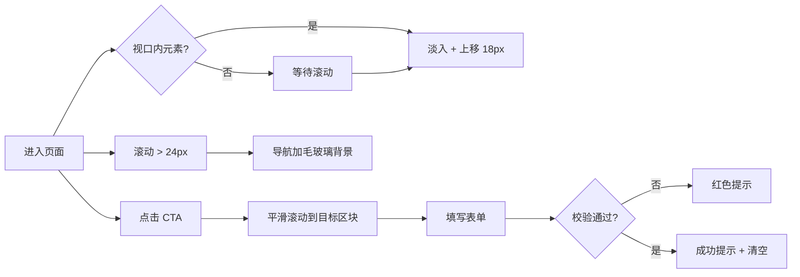

# 云栖智能官网 · PRD

> 版本 v1.0　｜　作者：夏天明　｜　更新：2026-10
> 项目类型：纯静态单页官网　｜　部署：GitHub Pages

---

## 1. 背景与目标

### 1.1 背景

云栖智能（YunQi AI）是一个虚构的三人 AI 应用工作室，需要一个"能被客户打开看 30 秒就记住"的官网。传统模板站的问题：加载慢、信息密度低、千篇一律。

### 1.2 目标

| 编号 | 目标 | 衡量方式 |
|---|---|---|
| G1 | 首屏 1 秒内呈现核心主张 | 首屏 HTML+CSS 文本 < 80KB，无外部字体与图片依赖 |
| G2 | 访客能看懂"我们做什么产品" | 首屏下方 1 屏内出现 3 个产品卡片 |
| G3 | 能引导到联系动作 | 每屏至少 1 个 CTA，最终落在联系表单 |
| G4 | 零运维 | 纯静态，GitHub Pages 托管，无构建步骤 |

### 1.3 非目标

- 不做多语言（v1 只做中文）
- 不做真实表单后端（前端校验 + 成功提示即可）
- 不做博客/文档系统

---

## 2. 用户与场景

| 用户 | 场景 | 关心什么 |
|---|---|---|
| 潜在客户（中小企业主） | 从朋友转发链接点进来，手机打开 | 你做过什么、靠不靠谱、怎么联系 |
| 合作开发者 | 电脑端浏览，看技术品味 | 设计细节、响应式、加载速度 |
| 招聘方/老师 | 30 秒扫一眼 | 信息结构是否清晰、有没有细节 |

---

## 3. 信息架构

```
/ (单页)
├─ 顶部导航（固定，滚动后加毛玻璃背景）
│   ├─ 品牌标识
│   ├─ 产品 / 能力 / 价格 / 团队 / 联系
│   └─ 登录（占位） / 免费试用
├─ Hero
│   ├─ 版本徽章
│   ├─ 主标题（渐变强调"帮你落地"）
│   ├─ 引导段落 + 两个 CTA
│   ├─ 三个数字指标（滚动计数）
│   └─ 右侧 AI 对话卡片（动效演示）
├─ 产品（3 张卡片）
├─ 能力（四步流程）
├─ 定价（3 档，中间档强调）
├─ 团队（3 人卡片）
├─ 联系（左信息 + 右表单）
└─ 页脚（品牌 / 导航 / 备案号）
```

---

## 4. 功能清单

| 编号 | 功能 | 优先级 | 说明 |
|---|---|---|---|
| F1 | 固定导航 + 滚动变色 | P0 | `scrollY > 24` 时加 `.scrolled`，`backdrop-filter: blur` |
| F2 | 锚点平滑滚动 | P0 | `html { scroll-behavior: smooth }` |
| F3 | 移动端汉堡菜单 | P0 | < 720px 显示，展开后纵向排列 |
| F4 | 滚动入场动效 | P0 | IntersectionObserver，同组元素按索引延迟 70ms |
| F5 | 数字滚动计数 | P1 | `requestAnimationFrame` + easeOutCubic，1.1s |
| F6 | 聊天卡片打字动效 | P1 | CSS 关键帧，三点循环 |
| F7 | 表单校验 | P0 | 必填 + 邮箱正则，错误态红色提示 |
| F8 | 表单提交反馈 | P1 | 纯前端，成功后清空并提示 |
| F9 | 备案号/年份自动更新 | P2 | JS 写入当前年份 |
| F10 | 减少动效偏好 | P1 | `prefers-reduced-motion` 关闭动画 |

---

## 5. 交互流程



---

## 6. 页面规格

| 区块 | 关键规格 |
|---|---|
| 容器 | `min(1180px, 100% - 48px)`，移动端 `100% - 32px` |
| 断点 | 980px（两栏→一栏）、720px（隐藏导航链接，显示汉堡） |
| 字号 | H1 `clamp(34px, 4.6vw, 60px)`，正文 15–16.5px，行高 1.7 |
| 圆角 | 卡片 18px，按钮 10–12px，徽章 999px |
| 主色 | `#5eead4`（青）→ `#818cf8`（靛）渐变 |
| 背景 | `#070b16` + 三层径向渐变光晕（fixed，blur 6px） |
| 阴影 | 卡片 `0 24px 60px -24px rgba(0,0,0,.85)` |
| 动效时长 | 入场 0.7s cubic-bezier(.22,1,.36,1)，悬停 0.3s |

---

## 7. 非功能需求

- **性能**：无外部字体、无框架、无图片（图标用内联 SVG），总传输 < 120KB
- **可访问性**：语义化标签（header/main/section/nav/footer）、`aria-label`、对比度 ≥ 4.5:1、键盘可达
- **SEO**：title/description/og 标签齐备，单个 h1
- **兼容性**：Chrome/Edge 最近 2 个版本，Safari 16+；不支持 IE
- **降级**：JS 关闭时内容仍完整可读（动效元素初始 opacity 由 JS 控制）

---

## 8. 验收标准

- [ ] 1440 / 1024 / 768 / 375 四个宽度下无横向滚动条
- [ ] 首屏无图片，HTML 文本 < 80KB
- [ ] 所有锚点点击后平滑滚动到对应区块，且不被固定导航遮挡
- [ ] 移动端菜单可开可关，点击条目后自动关闭
- [ ] 滚动行为流畅（DevTools Performance 无长任务 > 50ms）
- [ ] 表单空提交显示"请填写称呼"，错误邮箱显示"邮箱格式看起来不太对"
- [ ] 关闭 JS 后所有文字内容可见
- [ ] Lighthouse：Performance ≥ 95，Accessibility ≥ 95

---

## 9. 里程碑

| 阶段 | 内容 | 产出 |
|---|---|---|
| D1 | 信息架构 + 视觉方向 | 本 PRD |
| D1 | HTML 骨架 + 语义结构 | `index.html` |
| D2 | 样式系统 + 响应式 | `assets/css/style.css` |
| D2 | 交互脚本 | `assets/js/main.js` |
| D3 | 自测 + 上线 GitHub Pages | 公网地址 |

---

## 10. 风险

| 风险 | 应对 |
|---|---|
| 深色主题在投影仪上偏暗 | 提高正文对比度至 `#9aa7bd` 以上，关键信息用白色 |
| backdrop-filter 在低端机卡顿 | 仅导航栏使用，且限制 blur 半径 |
| GitHub Pages 缓存旧文件 | 文件名不含 hash，部署后强制刷新验证 |
